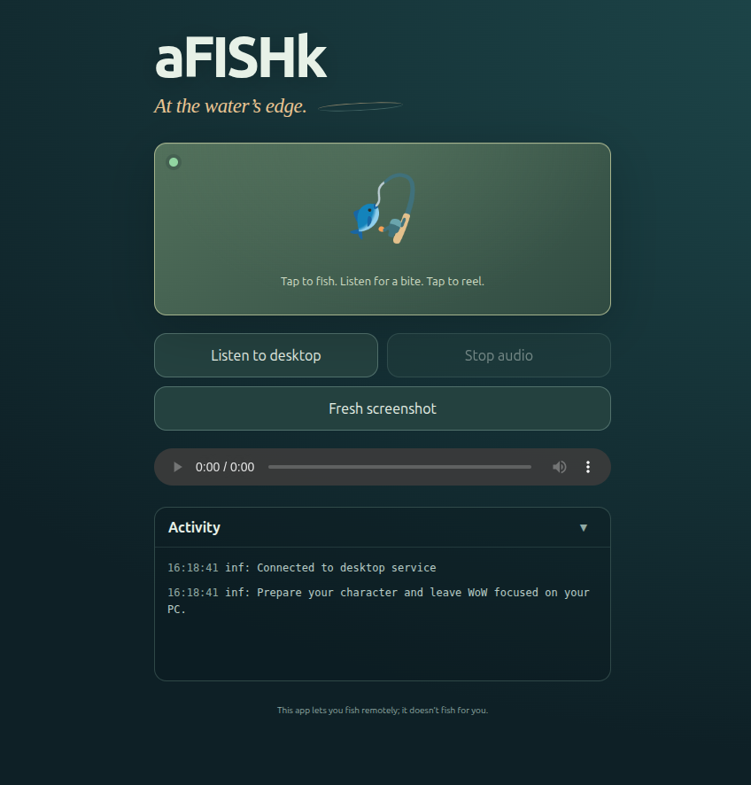

# aFISHk

**Fish in WoW: Forever from your phone, using your own Windows or Linux desktop,
and the WiFi or a VPN.** Hear the game through your browser, tap to cast or reel,
and take a screenshot when you want to check the scene. Each fishing tap sends your configured cast/reel key
to the focused WoW window through FishFry. There is no automatic casting, bite
detection or input timer. Use Moonlight/Parsec/TeamViewer/Rustdesk/VNC/Remote Desktop
separately to manage your character or the desktop.

<p align="center"></p>

## Requirements

- WoW: Forever and [FishFry Forever](https://www.curseforge.com/wow/addons/fishfry-forever),
  installed by you, with manual cast/reel bound to your fishing key (default **F**).
- A signed-in, unlocked desktop with WoW focused.
- Some means to keep the desktop session awake and signed in.
- A phone browser and your own LAN/VPN connection. You manage VPN, DNS, firewall
  rules, the addon and sleep/lock settings.
- Direct IPv4 UDP connectivity for audio, in addition to the web connection.

### Windows

**Windows 11 on an Intel/AMD x64 PC.** Run WoW and aFISHk as the same normal user;
**do not use “Run as administrator.”** Use WoW in windowed or borderless mode for
screenshots.  Windows ARM builds are not provided.

Audio captures the **Windows default playback device**, including other desktop
sound. After changing playback devices, stop listening and start listening again.

### Linux

**Nobara/Fedora, KDE Plasma 6 and Wayland**, with PipeWire Pulse compatibility,
FFmpeg supporting `pulse` input and `libopus`, and ydotool. **The Linux setup helper
install these runtime dependencies.** Other Linux desktop environments are not yet supported.

Audio captures the selected Pulse monitor, including other desktop sound. After changing
playback devices, stop listening and start listening again (a service restart may be
required on linux as well).

## Install on Windows

1. Download `afishk_VERSION_windows_amd64_setup.exe` from
   [Releases](https://github.com/justinnamilee/aFISHk/releases) and run it as your
   normal desktop user. The installer includes FFmpeg and installs only for you.
2. Optionally select **Start aFISHk when I sign in**; it is off by default.
3. Open **aFISHk** from the finish page or Start Menu. First run opens a local
   browser setup page on this computer.
4. Click **Identify WoW**, then focus the game within five seconds. Return to
   setup.
5. Choose your desktop LAN/VPN address, connectable URL, and IPv4 audio.
6. Configure your fishing and lure keys (lure is optional), and save settings.
7. Copy the generated browser password, then click **Finish setup**. The companion
   starts. Scan the QR code or open the displayed address on your phone, then sign
   in with any username and that password.

The installer does not open firewall ports or install FishFry. Windows may warn
about an unsigned installer; **only install downloads you trust from this project's
releases**. `SHA256SUMS` is provided alongside the downloads.

| Item | Location |
| --- | --- |
| Program and bundled FFmpeg | `%LOCALAPPDATA%\Programs\aFISHk` |
| Configuration | `%APPDATA%\afishk\config.json` |
| Browser password | `%APPDATA%\afishk\token` |
| Last screenshot and logs | `%LOCALAPPDATA%\afishk` |

Start Menu includes **aFISHk**, **Stop aFISHk**, **Settings folder**, **Logs folder**
and **Uninstall aFISHk**. Opening aFISHk again opens its web page without starting
a second copy. Use Stop aFISHk before editing configuration, then launch it again.
The password can be retrieved from the `token` file if you lose it.

For updates, run the new installer. It stops the old copy and preserves your
configuration and password. Use **Re-run browser setup after updating** to edit
settings, or open aFISHk afterward. Rerunning the installer also lets you change
the start-at-sign-in option. Uninstall removes the program and
startup entry but keeps your configuration, password and cached files.

## Install on Linux

Run commands in your logged-in Plasma session as your normal user. Only system
preparation uses sudo; aFISHk runs as you with no special permissions (except
sending the configured binding through ydotool).

### From a release

Download the Linux archive for your CPU (`amd64` or `arm64`) and `SHA256SUMS` from
[Releases](https://github.com/justinnamilee/aFISHk/releases). Verify and extract it:

```bash
sha256sum --ignore-missing --check SHA256SUMS
tar -xzf afishk_v1.0.0_linux_amd64.tar.gz
cd afishk_v1.0.0_linux_amd64
./scripts/linux/install-dnf-plasma-wayland.sh
```

Replace the version and architecture with your download. Releases need no Go,
Make, compiler or formatter. Existing FFmpeg is preserved; otherwise setup
requests `ffmpeg-free` from your enabled repositories.

If you already manage ydotool, add `--existing-ydotool`. Set `YDOTOOL_SOCKET` in a
`systemctl --user edit afishk` override if needed; the dedicated daemon's default
socket is `/run/afishk-input-$(id -u)/socket`.

### From source

Install Git, Make and Go 1.25 or newer, then:

```bash
sudo dnf install git make golang
git clone https://github.com/justinnamilee/aFISHk.git
cd aFISHk
make build
./scripts/linux/setup-dnf-plasma-wayland.sh
make install
```

### Configure and start

Both linux installation methods use the same browser setup:

```bash
~/.local/bin/afishk setup --web
```

1. Click **Identify WoW**, then focus the game within five seconds. Return to
   setup.
2. Choose your desktop LAN/VPN address, connectable URL, and IPv4 audio.
3. Configure your fishing and lure keys (lure is optional), and save settings.
4. Copy the generated browser password, then click **Finish setup**. The companion
   starts. Scan the QR code or open the displayed address on your phone, then sign
   in with any username and that password.

Alternatively, terminal setup is available with `afishk inspect` followed
by `afishk setup`.

#### Start the installed user service

```bash
systemctl --user import-environment WAYLAND_DISPLAY DISPLAY XDG_CURRENT_DESKTOP
systemctl --user start afishk
```

Optionally enable startup with your graphical session:

```bash
systemctl --user enable afishk
```

#### Additional linux installation notes

The binary is installed in `~/.local/bin/afishk`; config and password are in
`${XDG_CONFIG_HOME:-$HOME/.config}/afishk/`. The cache follows XDG cache settings.
Installation preserves settings and does not start or restart aFISHk. To change
an existing setup, edit `config.json` and restart the user service.

### Linux updates and removal

For source updates:

```bash
git pull --ff-only
make build
make install
systemctl --user restart afishk
```

For release updates, verify/extract the new archive, then:

```bash
./scripts/linux/install-dnf-plasma-wayland.sh --skip-setup
systemctl --user restart afishk
```

To change settings through setup, see [Re-run setup](#re-run-setup). To disable startup and stop the app,
use `systemctl --user disable --now afishk`. If no longer needed, disable the
input daemon with `sudo systemctl disable --now "afishk-input-$(id -u).service"`.

## Connection and everyday use

In browser setup, click **Record fishing key** and press your in-game binding, or
type it (for example, `Ctrl+Shift+4`). Letters, digits, F1–F12, punctuation,
navigation and numpad keys are supported. Existing configurations use **F**.

**Add lure** sends the optional **Lure key** you record in the same setup screen.
Leaving it blank makes the button log an error when tapped. To set it later,
edit `config.json` (for example, `"lure_key": "Shift+2"`) and restart aFISHk.

### Port requirements

Allow these **destination ports on the desktop**, restricted to your trusted
LAN/VPN clients:

| Protocol | Default ports | Purpose |
| --- | --- | --- |
| TCP | `8787` | Web page, controls, screenshots and audio negotiation |
| UDP | `49160–49180` | WebRTC audio |

### Re-run setup

Setup keeps your existing configuration until you choose to save. It starts
with your saved settings and keeps your current browser password.

- **Windows:** Stop aFISHk from the Start Menu. Select **Re-run browser setup after
  updating** in the installer, or run `.\afishk.exe setup --web --overwrite` from
  the install folder. Finish setup, then open aFISHk from the Start Menu.
- **Linux:** Run `systemctl --user stop afishk`, then `afishk setup --web --overwrite`.
  Omit `--web` for terminal setup. After saving, run `systemctl --user start afishk`.

Both setup modes show a QR code for the control page. Use the browser password
when your phone prompts you to sign in.

To generate a new browser password, run `afishk setup --rotate-token` (use
`.\afishk.exe` on Windows), then restart aFISHk. Retrieve the new password from the
configured token file.

### Browser setup tips

| Browser setup field | What to enter |
| --- | --- |
| Listening address and web port (`listen`) | The local address and TCP port for the web server. Setup suggests a desktop LAN IP. Use `0.0.0.0` to listen on all IPv4 interfaces. |
| Browser address (`public_origin`) | The exact URL your phone opens, including scheme and port, without a path. A hostname your phone can resolve is fine, for example `http://suzuki:8787`. |
| Desktop IPv4 address for audio (`ice_address`) | A numeric desktop IPv4 your phone can reach over LAN or VPN, for example `10.6.6.34`. A private LAN IP is fine. Hostnames and `0.0.0.0` are invalid here. |

### Audio tips

Audio defaults to the same LAN IP. Change its UDP port range only in
`config.json` using `udp_min` and `udp_max`, then restart aFISHk.
Your phone needs a direct UDP route for audio even when the web page uses an HTTP reverse proxy.

Open your configured browser URL. Sign in with **any username** and your generated
token as password. Tap **Listen to desktop**; if autoplay is blocked, tap Play in the
audio player. Keep the page in the foreground. Tap the fishing button to cast,
listen for a bite, then tap to reel.

### Themes

Tap the colour wheel beside **aFISHk** to cycle through the themes. The first tap
switches from Classic to Dark Mode. Your browser remembers your choice for the next visit.

Feel free to open a PR with new theme(s), they are always welcome.

## Troubleshooting

| Symptom | What to do |
| --- | --- |
| Page unreachable | Check the chosen address, VPN routing and TCP firewall rule. On Windows, open aFISHk and inspect its Logs folder; on Linux, use `systemctl --user status afishk`. |
| Hostname/origin rejected | Open exactly `public_origin`; ensure phone DNS resolves that hostname. |
| Repeated login prompt | Use the contents of `token` as the password, not the filename. |
| Input rejected | Focus the exact configured WoW window and unlock the desktop. On Windows, release the bound key and modifier keys and run both programs without administrator elevation. On Linux, use `./scripts/linux/doctor.sh`. |
| Game moved or title changed | Update the exact game class/title in `config.json`. On Windows, also update `game_executable` if WoW moved to a different path. |
| Windows screenshot blank or unavailable | Use windowed/borderless mode and keep WoW focused. Some game/rendering combinations cannot supply a window screenshot; aFISHk will not capture the whole desktop instead. |
| Linux screenshot denied | Use the installed binary and KDE desktop entry; log out/in if permissions are cached. Do not disable KWin permission checks globally. |
| Audio silent | Ensure sound plays on the default Windows playback device or selected Linux Pulse monitor. After switching devices, stop/start listening. |
| Audio never connects | Check `ice_address` and UDP firewall rules; opening TCP alone is insufficient. |
| Audio drops or flutters | Compare LAN/VPN and speaker/Bluetooth playback; keep the phone page foregrounded. Stop/start listening to reconnect. |
| Setup says config exists | Use `afishk setup --web --overwrite` to edit existing settings. |

For Linux logs use `journalctl --user -u afishk -f`. For a foreground run, stop
the user service, set `YDOTOOL_SOCKET=/run/afishk-input-$(id -u)/socket`, and run
`~/.local/bin/afishk`. Never run as root to fix desktop permissions.

## Advanced configuration

The browser wizard supports plain HTTP on a trusted LAN/VPN, built-in HTTPS with
your own PEM certificate/key files, or an external HTTPS proxy. **Basic
authentication alone does not encrypt HTTP.** For a proxy, bind the app to
loopback/lan and preserve Host, Origin, Authorization and X-CSRF-Token headers.
Forwarded headers are not trusted. UDP media still needs its **direct** route.
Certificate issuance and renewal are your responsibility; restart after replacing
certificate files.

Linux install paths accept `BINDIR`, `CONFIGDIR`, `SYSTEMD_USER_DIR`,
`APPLICATIONSDIR` and `BINARY` as environment variables or Make arguments. Directory
overrides must be absolute and contain only letters, digits, underscore, dot,
slash or hyphen. Custom systemd/KDE directories must be discoverable by those
services. Use the same overrides for upgrades, and pass a custom config path via
`--config` to setup or manual runs.

## License and credits

- aFISHk is GPL-3.0-or-later; see [LICENSE](LICENSE).
- [FishFry](https://www.curseforge.com/wow/addons/fishfry-forever) is installed separately.
- [FFmpeg](https://ffmpeg.org/) is bundled in the Windows installer under
  LGPL-2.1-or-later, with [Opus](https://opus-codec.org/) under its BSD license.
  The matching source and build script are in the Windows media source archive
  beside each installer on [Releases](https://github.com/justinnamilee/aFISHk/releases).
- Linux integration uses [KWin](https://develop.kde.org/docs/plasma/kwin/),
  [ydotool](https://github.com/ReimuNotMoe/ydotool) and [PipeWire](https://pipewire.org/).
- Audio transport uses [Pion WebRTC](https://github.com/pion/webrtc).
- App icon artwork by Twitter and contributors, adapted with padding and a dark teal background. [Twemoji](https://github.com/jdecked/twemoji/tree/v16.0.1) · [CC BY 4.0](https://creativecommons.org/licenses/by/4.0/).
- Dependencies retain their own licenses and copyrights.
